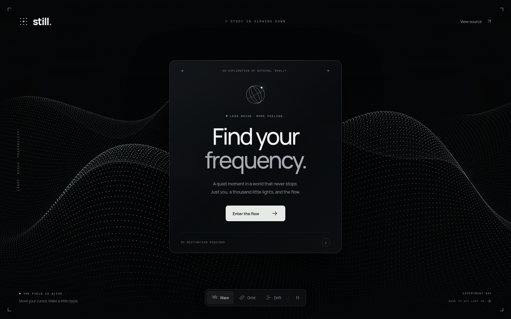

# STILL

A quiet moment in a world that never stops. A minimal, interactive particle field with a glass panel, soft monochrome light, and a little space to breathe.

**[Enter the experience →](https://oceanplexian.github.io/still-field/)**



## Explore

- Move your pointer to gently change the perspective.
- Click or tap the open field to send a ripple through it.
- Switch between **Wave**, **Orbit**, and **Drift**.
- Choose **Enter the flow** to dissolve the panel. Press **Escape** or **Back to still** to return.
- Pause the animation at any time. Reduced-motion preferences start the scene paused.

## Run locally

No install or build step is needed. Serve this directory with any static server:

```sh
python3 -m http.server 8080
```

Then open `http://localhost:8080`.

## Under the surface

Plain HTML, CSS, and JavaScript. Native WebGL animates a grid of up to 38,400 points using vertex shaders and a perspective camera. A Canvas 2D fallback works without WebGL. Rendering stops while the tab is hidden or the scene is paused; pixel density is capped and smaller screens use fewer particles.

All assets are local. No frameworks, build dependencies, analytics, cookies, or external requests. The Manrope typeface is bundled under the SIL Open Font License; see `assets/OFL-Manrope.txt`.

GitHub Pages serves the root of the `main` branch. Pushing to `main` publishes updates.

## License

MIT. Make something lovely with it.
